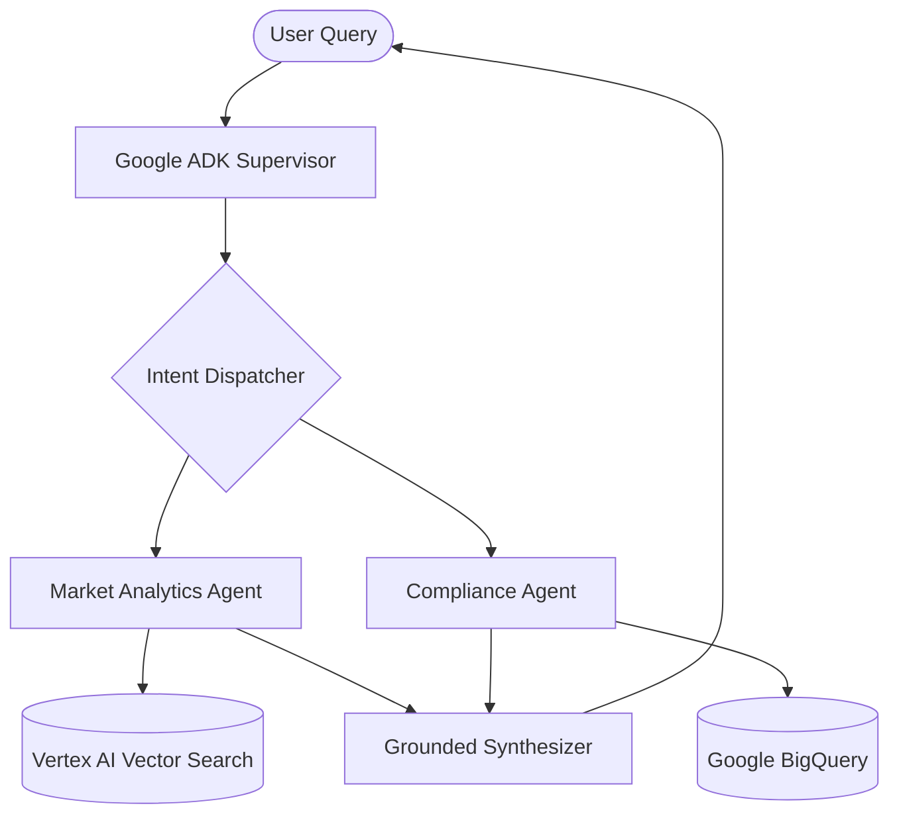

# Architecting Hierarchical Multi-Agent RAG

Monolithic Retrieval-Augmented Generation (RAG) pipelines often collapse when deployed across multifaceted enterprise domains. When a single prompt or retrieval stage attempts to answer investment advice, regulatory compliance, and real-time market metrics simultaneously, context dilution and retrieval hallucination inevitably degrade answer fidelity.

In this article, we explore how to design a **Hierarchical Multi-Agent RAG** architecture using the **Google Agent Development Kit (Google ADK)** and **Vertex AI**.

---

## 1. The Multi-Agent Advantage

Instead of relying on an oversized prompt, a hierarchical architecture splits domain responsibilities:

- **Supervisor Agent**: Understands intent, tracks conversational turns, and dispatches sub-tasks.
- **Domain Worker Agents**: Isolated agents equipped with specific toolchains (e.g. Vector Search index for compliance, BigQuery connection for financial data).
- **Synthesis Agent**: Aggregates worker outputs and verifies factual alignment before responding.



---

## 2. Setting Up Google ADK Supervisor

Using Google ADK's orchestrator patterns, we can define our supervisor:

```python
from google.adk import Agent, SequentialAgent
from google.adk.tools import VertexSearchTool, BigQueryTool

compliance_agent = Agent(
    name="compliance_worker",
    tools=[VertexSearchTool(datastore_id="financial-compliance-v1")],
    instruction="Strictly retrieve and cite regulatory financial frameworks."
)

analytics_agent = Agent(
    name="analytics_worker",
    tools=[BigQueryTool(dataset="market_intelligence")],
    instruction="Execute analytical SQL queries over quarterly earnings datasets."
)
```

---

## 3. Real-World Lessons from Production

1. **Keep Retrieval Tools Granular**: Give each worker agent its own distinct datastore namespace. Combining all data into a single vector index increases nearest neighbor collisions.
2. **Deterministic Confidence Thresholds**: Reject vector chunks with cosine similarity below 0.72 to protect downstream LLM generation from irrelevant context.
3. **Stream via FastAPI**: Always stream responses via Server-Sent Events (SSE) to deliver instantaneous perceived latency under 800ms.

