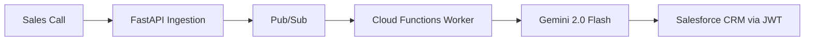

# Serverless Audio Transcription & MEDDPICC Extraction with Gemini 2.0 Flash

Enterprise sales intelligence depends on identifying key qualification factors such as **MEDDPICC** (Metrics, Economic Buyer, Decision Criteria, Decision Process, Identify Pain, Champion, Competition) across customer discovery conversations.

In this walkthrough, we examine how to orchestrate a serverless ETL pipeline that ingests long sales transcripts and structures them directly into Salesforce Opportunities.

---

## Architecture Flow



---

## 1. Event-Driven Ingestion

When a recording finishes processing, Gong triggers an encrypted webhook. Rather than blocking the webhook receiver, we validate the signature and enqueue the transcript identifier into Google Cloud Pub/Sub:

```python
from fastapi import FastAPI, Header, HTTPException, Request
import json

app = FastAPI()

@app.post("/api/gong-webhook")
async def handle_gong_event(request: Request, x_gong_signature: str = Header(...)):
    raw_body = await request.body()
    if not verify_hmac(raw_body, x_gong_signature):
        raise HTTPException(status_code=401, detail="Invalid signature")
    
    payload = json.loads(raw_body)
    publish_to_pubsub("gong-transcripts-topic", payload)
    return {"status": "enqueued"}
```

---

## 2. Structured Extraction via Pydantic & Gemini 2.0 Flash

Gemini 2.0 Flash's massive context window and native JSON mode allow us to pass full hour-long transcripts without manual chunking:

```python
from pydantic import BaseModel, Field
from typing import List, Optional

class MEDDPICCOutcome(BaseModel):
    metrics: List[str] = Field(description="Quantifiable business impact metrics mentioned by client")
    economic_buyer: Optional[str] = Field(description="Individual with final budgetary approval")
    decision_criteria: List[str] = Field(description="Technical and vendor evaluation criteria")
    decision_process: List[str] = Field(description="Timeline, procurement steps, legal review")
    identified_pain: List[str] = Field(description="Primary operational pain points")
    champion: Optional[str] = Field(description="Internal advocate actively supporting deal")
    competition: List[str] = Field(description="Competing software or internal alternatives")
```

---

## 3. Key Production Takeaways

- **Sub-10 Second Processing**: Gemini 2.0 Flash digests 12,000+ words in under 7 seconds.
- **Cost Reduction**: Lowered operational LLM compute costs by >70% compared to previous generation models.
- **Auditable Citations**: Each extracted field maps back to specific timestamped dialog turns for sales manager verification.

