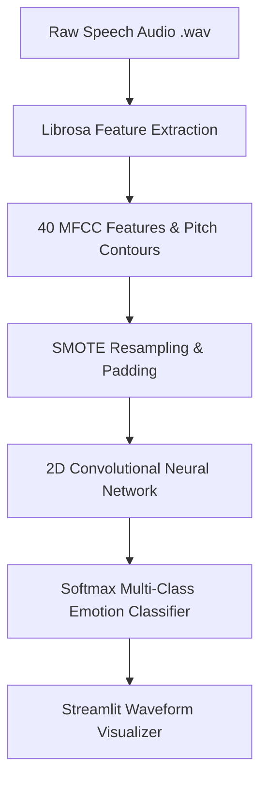

## Overview

Human speech conveys rich affective nuances beyond textual transcripts. Detecting emotional states directly from raw audio waveforms is vital for customer service sentiment tracking, mental health monitoring, and adaptive voice assistants.

This project developed an end-to-end **Speech Emotion Recognition (SER)** system. By extracting acoustic feature representations—primarily **Mel-Frequency Cepstral Coefficients (MFCCs)**—and resolving severe dataset imbalances with **SMOTE**, the system trains a multi-layer **Convolutional Neural Network (CNN)** that predicts emotions such as happy, sad, angry, surprised, neutral, and fearful.

## Technical Methodology

### 1. Acoustic Feature Engineering
- Used **Librosa** to extract 40 MFCC coefficients, capturing spectral envelope characteristics mimicking human auditory perception.
- Applied zero-padding and fixed-length windowing to normalize audio sample durations.

### 2. Dataset Balancing via SMOTE
- Under-represented emotions were balanced using SMOTE, synthesizing feature-space vectors to ensure equitable gradient updates during model backpropagation.

### 3. Model Architecture & Evaluation
- Built a multi-layer 2D CNN with Dropout (0.3), Batch Normalization, and Max Pooling layers to capture local spectral-temporal motifs.
- Achieved **61% test accuracy** across 6 distinct emotional classes on standard benchmark datasets (RAVDESS / TESS), well above random baseline (16.7%).

### 4. Interactive Live Classifier
- Built a **Streamlit** application allowing users to upload or record voice clips, view audio waveforms and spectrogram heatmaps, and inspect probabilistic emotion distribution bar charts.

