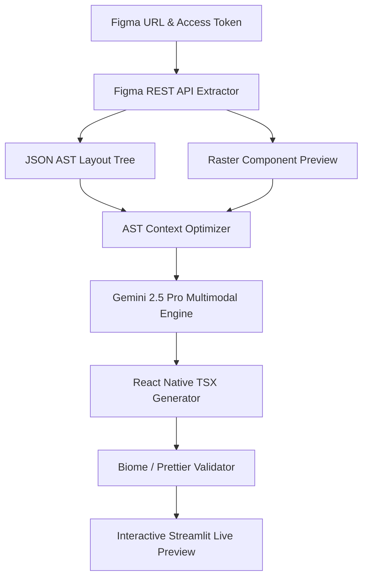

## Overview

Translating Figma UI/UX designs into pixel-perfect React Native mobile code is traditionally a tedious, manual process prone to stylistic inconsistencies and layout discrepancies.

This project built an intelligent, end-to-end **Design-to-Code Pipeline** that extracts AST node trees directly from the Figma REST API, pairs them with visual raster renders, and utilizes **Gemini 2.5 Pro** to generate maintainable, production-ready React Native code with TypeScript and Tailwind/StyleSheet support.

## Technical Architecture

### 1. AST Traversal & Simplification
- The Figma API produces massive JSON representations containing dozens of redundant vector points and metadata.
- A custom Python AST visitor filters noise, preserving only critical geometry: Auto Layout (flex direction, padding, gap, alignment), typographic styles, colors, and border radii.

### 2. Multimodal Code Synthesis
- Passes both the simplified node hierarchy and the rendered visual raster into **Gemini 2.5 Pro**.
- The model matches visual nuances against structural layout tokens to infer proper native component primitives (`<View>`, `<Text>`, `<Pressable>`, `<ScrollView>`).

### 3. Developer Interface
- Provided an intuitive **Streamlit** dashboard where developers paste their Figma file URL, preview extracted frames, adjust generation settings (TypeScript vs. JavaScript, Inline Styles vs. NativeWind), and copy or download the generated source code.

## Key Outcomes

- **80% Faster Prototyping**: Drastically shortened the cycle from completed Figma design to functional mobile prototype.
- **Clean Code Quality**: Enforces strict typing with TypeScript interfaces for component props and clean modular separation.
- **Auto Layout Fidelity**: Preserves responsive wrapping, padding, and alignments seamlessly across both iOS and Android viewports.

