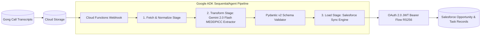

## Overview

Enterprise sales teams spend hours each week manually summarizing discovery calls and typing qualification notes into CRM systems. Manual data entry often leads to inconsistent opportunity records, missed deal risks, and out-of-date sales pipelines.

This proof-of-concept project built an automated **Agentic ETL (Extract, Transform, Load) Pipeline** that ingests raw Gong call recordings and transcripts, processes them through an LLM qualification workflow, and automatically enriches **Salesforce Opportunities** with structured **MEDDPICC** criteria.

## Scope of Ownership

I architected and delivered the end-to-end 3-stage agentic ETL pipeline:
- **Pipeline Orchestration**: Built the sequential multi-agent execution flow using **Google ADK SequentialAgent**.
- **Transformation Engine**: Crafted structured extraction prompts for **Gemini 2.0 Flash** with strict Pydantic v2 validation.
- **Salesforce Integration**: Developed the secure CRM client using OAuth 2.0 JWT Bearer flow with RS256 private-key assertions.
- **Serverless Deployment**: Packaged the workflow into event-driven GCP Cloud Functions with Cloud Storage triggers.

## System Architecture

### Architectural Workflow

1. **Stage 1 — Fetch & Ingestion**:
   - Webhook notifications from Gong upload completed call transcripts into a secure Google Cloud Storage (GCS) bucket.
   - An event-driven Cloud Function triggers the initial pipeline stage, validating payload integrity and isolating conversation turns by speaker.

2. **Stage 2 — Transformation with Google ADK SequentialAgent**:
   - Uses **Google ADK `SequentialAgent`** to enforce deterministic stage progression (`Fetch -> Transform -> Load`).
   - Merged transcripts are evaluated against the enterprise **MEDDPICC** framework:
     - **M**: Metrics (quantifiable business value)
     - **E**: Economic Buyer (budget authority)
     - **D**: Decision Criteria (technical & commercial requirements)
     - **D**: Decision Process (timeline & evaluation steps)
     - **I**: Identify Pain (core business problem)
     - **C**: Champion (internal advocate)
     - **C**: Competition (competing vendors & internal alternatives)
   - The extraction runs through **Gemini 2.0 Flash** with temperature set to `0.1`, outputting strictly validated Pydantic JSON schemas.

3. **Stage 3 — Load & Salesforce CRM Integration**:
   - Validated findings are formatted into Salesforce sObject payloads.
   - Authenticates using **OAuth 2.0 JWT Bearer flow with RS256 signing**, eliminating brittle static API keys or long-lived user passwords.
   - Updates Opportunity custom fields, writes call summary notes, and automatically generates task reminders for account executives.

## Key Engineering Decisions & Trade-Offs

### 1. Non-Bypassable Sequential Boundaries
In customer-facing CRM systems, sending incomplete or hallucinated data can mislead sales leadership.
- Using Google ADK `SequentialAgent` guaranteed that if Stage 2 (Transform) encountered schema validation errors or low confidence scores, the pipeline halted before Stage 3 (Load) could ever execute.
- Partial failures log diagnostic telemetry into Cloud Logging rather than pushing malformed data to Salesforce.

### 2. Machine-to-Machine JWT RS256 Authentication
- Rather than using interactive OAuth authorization codes or storing Salesforce user passwords in environment variables, implemented server-to-server JWT Bearer token exchange.
- Signed assertions using an RS256 private key stored in Google Cloud Secret Manager, minting short-lived session tokens dynamically without human intervention.

### 3. Cost-Efficient Long-Context Processing
- Discovery calls routinely span 45 to 60 minutes, generating transcripts between 8,000 and 15,000 words.
- Gemini 2.0 Flash provided a wide context window capable of ingesting the entire raw transcript in a single pass while maintaining execution times under 6 seconds per call.

## Measurable Results

- **Automated CRM Enrichment**: Completely eliminated manual post-call notes logging for test opportunities.
- **Consistent MEDDPICC Coverage**: Standardized deal qualification data across all ingested discovery sessions.
- **Sub-6-Second Processing**: Fast extraction cycle from transcript arrival to Salesforce record creation.
- **Fault-Isolated Execution**: Single malformed call records log errors without impacting processing of adjacent calls.
