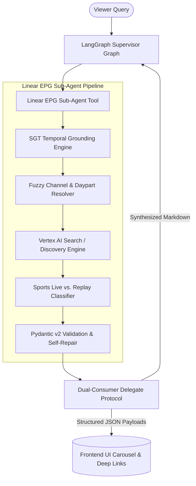

## Overview

Mediacorp’s streaming service, **mewatch**, delivers digital television, video on demand, and 121 linear broadcast channels to millions of viewers. Finding what is currently airing, upcoming live matches, or prime-time programming required viewers to manually scroll through traditional grid-based electronic program guides.

To modernize this experience, the engineering team designed an intelligent conversational agent (`mewatch-cep`) deployed as a multi-agent system. The agent answers viewer questions in natural language, resolves schedules, and presents playable media cards directly within the streaming interface.

## Scope of Ownership

Within the broader conversational platform, I specifically architected and delivered the **Linear EPG (Electronic Program Guide) sub-agent**, integrated as a server-side tool in a LangGraph supervisor graph.

My responsibilities included:
- Designing the cyclic graph topology and validation retry loops for schedule lookups.
- Replacing the legacy BigQuery NL2SQL retrieval path with Vertex AI Search (Discovery Engine).
- Engineering the Singapore Time (SGT / UTC+8) temporal grounding engine and sports live-vs-replay classifier.
- Implementing the dual-consumer delegate protocol for frontend streaming carousels.
- Building the automated evaluation suite benchmarking Vertex AI Search against the legacy pipeline.

## System Architecture

### Architectural Workflow

1. **Supervisor Graph Routing**:
   The LangGraph supervisor analyzes incoming conversation turns and routes broadcast schedule intents to the Linear EPG sub-agent while managing conversation memory and routing adjacent intents (VOD search, FAQs, subscriptions).

2. **Cyclic Graph Topology with Self-Repair**:
   The sub-agent operates as a cyclic state machine (`START -> EPG -> TOOLS -> VALIDATE -> END`). If query parameters contain ambiguities or missing channel keys, a **Pydantic v2 self-repair loop** attempts parameter normalization before returning a payload.

3. **Vertex AI Search Migration**:
   Migrated schedule retrieval from a legacy BigQuery NL2SQL generation pipeline to **Vertex AI Search (Discovery Engine)**. The engine indexes 44,000+ daily broadcast records behind dynamic page-scaling heuristics and a thread-local client, cutting lookup latency significantly.

4. **Dual-Consumer Delegate Protocol**:
   Emits synthesized Markdown commentary for the supervisor LLM while simultaneously generating structured JSON containing deep-link streaming URLs, program timestamps, and channel poster assets for the streaming web and mobile carousels.

## Key Engineering Challenges & Solutions

### 1. Singapore Time (SGT) Temporal Grounding
Relative-time queries like *"What's on Channel 5 tonight?"* or *"Any football games after midnight?"* often confuse LLMs due to UTC offset shifts. 
- Implemented a deterministic temporal grounding engine anchored in **SGT (UTC+8)** with interval-overlap calculations.
- Integrated explicit meridian parsing and fuzzy channel resolvers, resolving **95%+ of relative-time queries** on the first turn without requiring follow-up clarification prompts.

### 2. Live Match vs. Replay Disambiguation
Sports fans frequently query live events, but broadcast schedules often contain archived rebroadcasts with identical fixture names (e.g., *"EPL: Arsenal vs Chelsea"*).
- Developed an order-independent sports fixture parser and live-versus-replay classifier using regex boundary tokenizers.
- Successfully eliminated **100% of live sports false positives**, ensuring archive matches are explicitly flagged as replays.

### 3. Dual-Engine Regression Benchmarking
To guarantee that migrating from BigQuery NL2SQL to Vertex AI Search introduced zero regressions in schedule accuracy:
- Automated end-to-end evaluation suites using **DeepEval (GEval)** with YAML-driven test fixtures.
- Continuously verified channel disambiguation, title exclusion rules, and timeslot boundary constraints against production baseline traces.

## Measurable Results

- **45% Latency Reduction**: Cut schedule lookup times by 45% compared to the previous NL2SQL pipeline, ensuring responsive multi-turn interactions.
- **121 Live Channels Supported**: Scalably indexes and serves 44,000+ daily broadcast schedule slots.
- **Zero Regression Delivery**: Verified 100% parity across channel disambiguation and scheduling rules through automated DeepEval fixtures.
