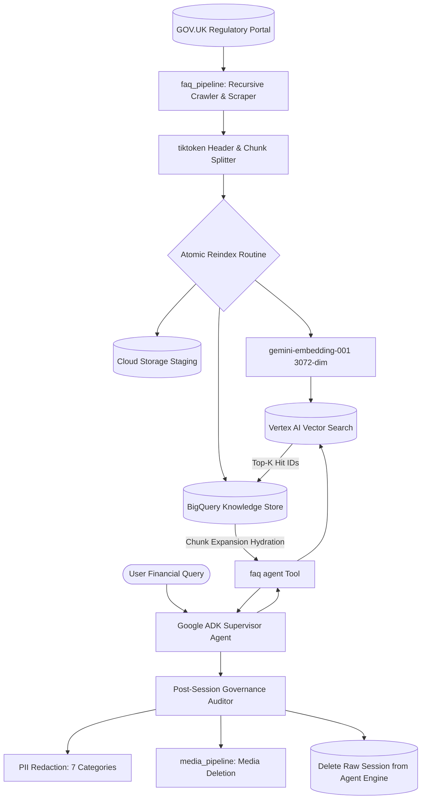

## Overview

The **AILA Money** platform is a multi-agent financial guidance system designed to answer user inquiries regarding personal finance, pensions, and UK regulatory frameworks. Because regulatory guidelines frequently update, the platform required an automated data ingestion engine alongside domain-specialized agents to provide strictly grounded answers.

## Scope of Ownership

Within the collaborative engineering repository (`aila-money-agenticai` on branch `dev`), my primary contributions centered on the regulatory ingestion pipeline, FAQ retrieval agent tool, and lifecycle cleanup:

- **`faq_pipeline`**: Engineered the scheduled crawler and transformation pipeline over GOV.UK financial guidance.
- **`faq agent` Tool**: Implemented the two-stage vector search retrieval tool utilized by the Google ADK supervisor.
- **`media_pipeline` (Media Deletion)**: Built the post-session media cleanup routines that purge temporary session artifacts and media files.
- **PII Governance Auditor**: Developed the automated session auditor that redacts sensitive personal data before session destruction.

## System Architecture

### Architectural Workflow

1. **Scheduled Ingestion Pipeline (`faq_pipeline`)**:
   - Executes recursive, depth-limited crawls across authorized GOV.UK domain paths.
   - Normalizes URLs, strips redundant HTML boilerplate, and transforms DOM elements into clean Markdown.
   - Chunks text based on Markdown header hierarchies and token counts using `tiktoken`.

2. **Atomic Full-Reindex Cycle**:
   - To prevent outdated regulatory guidance from persisting, an automated reindexing job purges stale vector datapoints, upserts fresh 3072-dimensional `gemini-embedding-001` embeddings to **Vertex AI Vector Search**, and updates reference records in **BigQuery**.

3. **Two-Stage Hydration with Chunk Expansion (`faq agent`)**:
   - Queries to the `faq agent` tool generate QA-optimized embeddings that match against the shared index filtered by regulatory category namespaces.
   - Rather than returning raw truncated chunks to the LLM, the tool resolves top hits to their parent document and pulls neighboring sibling chunks from BigQuery in sequence. This guarantees the LLM receives complete regulatory context with exact source URLs.

4. **Lifecycle Media Deletion (`media_pipeline`)**:
   - Financial queries involving uploaded user documents or generated charts stage files in Cloud Storage.
   - Built the automated cleanup service in `media_pipeline` that safely purges all ephemeral media assets and session buffers once processing concludes, preventing orphaned storage costs.

5. **Post-Conversation Governance Auditor**:
   - Automatically retrieves session transcripts from Vertex AI Agent Engine.
   - Masks 7 categories of sensitive PII (names, national insurance numbers, email addresses, phone numbers, bank details, postal codes, and monetary values).
   - Classifies the interaction against a fixed regulatory taxonomy using Gemini with structured Pydantic schemas, logs the audit record, and purges the raw source session.

## Pragmatic Engineering Decisions

- **Two-Stage Hydration over Fat Vectors**: Rather than bloating vector index datapoints with large text payloads, stored only 3072-dim vector embeddings and document IDs in Vertex AI Vector Search, hydrating full text from BigQuery. This kept vector search index memory low and search latency fast.
- **Chunk Expansion**: Single chunk semantic hits often miss important conditional clauses in regulatory text (e.g., *"provided that the threshold is met"*). Reassembling adjacent chunks gave the model complete context without hallucinations.
- **Fail-Safe Session Cleanup**: Scheduled Cloud Functions ensure temporary media files and unredacted session logs are destroyed even if an agent session is abandoned halfway through.

## Key Outcomes

- **Zero Regulatory Drift**: Atomic reindexing eliminated stale guidance across changing regulatory periods.
- **Complete Context Delivery**: Chunk expansion eliminated truncated answers, providing comprehensive guidance with verifiable source citations.
- **Audited Compliance**: 100% of session transcripts passed through automated PII redaction and taxonomy classification before deletion.
