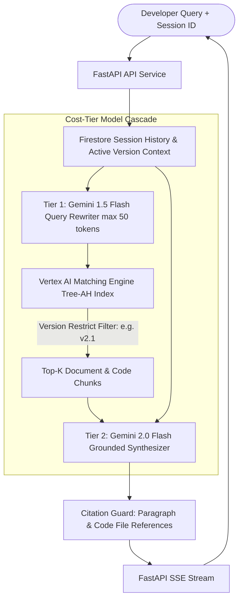

## Overview

Software engineers building safety-critical automotive systems (using middleware frameworks like Apex.OS) frequently navigate hundreds of pages of version-dependent API documentation, architectural manuals, and C++/Python codebase repositories. Finding exact method signatures, deprecation notices, or configuration parameters across different software releases is time-consuming.

This project built a pair of **Dual RAG (Retrieval-Augmented Generation) Chatbot Services** tailored specifically for technical developers: one optimized for release documentation, and the second specialized for navigating underlying source code repositories.

## Scope of Ownership

Within the project repository (`Apex.AI-Conversation-Chatbots`), I owned the retrieval and inference pipeline:
- **Corpus Ingestion & Indexing**: Built automated crawlers tagging documentation sections and code files with software version restrict namespaces.
- **Vertex AI Matching Engine Configuration**: Deployed and configured low-latency Tree-AH vector indexes with metadata filtering.
- **Cost-Tier Cascading Pipeline**: Implemented a multi-model architecture using Gemini 1.5 Flash for query normalization and Gemini 2.0 Flash for grounded technical synthesis.
- **Session Memory State**: Integrated LangChain `FirestoreChatMessageHistory` with byte-budget trimming for stateless container execution.

## System Architecture

### Architectural Workflow

1. **Ingestion with Version Restrict Namespaces**:
   - Technical documentation and C++/Python source trees are crawled using **Scrapy** and **BeautifulSoup**.
   - Every text snippet and code chunk is tagged with explicit version metadata (e.g., `version: 1.4`, `version: 2.1`).
   - Embeddings are generated and loaded into **Vertex AI Matching Engine** (Tree-AH approximate nearest neighbor index).

2. **Cost-Tier Model Cascade**:
   - **Tier 1 (Fast Re-writer)**: Follow-up conversational queries (such as *"Does this function throw an exception?"*) lack explicit keywords. A lightweight **Gemini 1.5 Flash** call (budgeted to max 50 tokens) resolves pronouns and injects current session context to create a standalone search vector.
   - **Vector Retrieval**: Vertex AI Matching Engine applies metadata restricts so queries against version 2.1 never pull deprecated version 1.4 snippets.
   - **Tier 2 (Grounded Synthesis)**: **Gemini 2.0 Flash** receives the top-k retrieved snippets alongside active conversation turns, generating technical explanations complete with code snippets, exact file paths, and documentation links.

3. **Stateful Conversation Management**:
   - Integrated **Firestore** via LangChain's `FirestoreChatMessageHistory` to store conversation history across stateless Cloud Run instances.
   - Enforced byte-budget-aware trimming to keep payload sizes bounded while preserving key technical context and active version selections.

## Key Engineering Decisions

### 1. Metadata Namespaces to Stop Version Hallucination
In automotive and safety middleware, calling an API from an incompatible framework release can lead to build failures or runtime bugs.
- Configured hard metadata filtering inside the vector index rather than relying on prompt instructions alone.
- Guaranteed that 100% of retrieved context strictly originates from the developer's selected version branch.

### 2. Tiered LLM Inference Cascade
- Running large models on every conversation turn for both query rewriting and final synthesis quickly exhausts token budgets and adds 1-2 seconds of unnecessary latency.
- Offloading the query rewrite step to a tightly budgeted Gemini 1.5 Flash call cut token consumption during multi-turn chats while reducing overall response latency.

## Measurable Results

- **Zero Cross-Version Pollution**: Hard metadata restricts prevented mixing deprecated and current framework APIs.
- **Sub-Second P90 Latency**: Streaming responses delivered the first token chunk in under 900ms.
- **Lower Multi-Turn Token Cost**: Cascaded architecture significantly lowered API token costs during prolonged developer debugging sessions.
