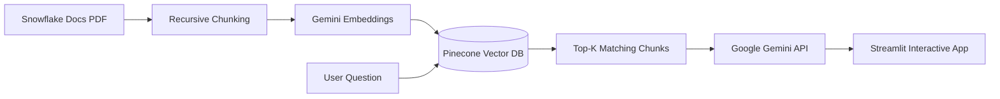

## Overview

Snowflake's extensive documentation and SQL syntax variations can make troubleshooting cloud data warehouse queries challenging for engineers and analysts.

This project developed a dedicated **Snowflake AI Assistant** that transforms comprehensive PDF technical documentation into high-dimensional vector embeddings stored in **Pinecone**, paired with **Google Gemini API** to provide precise code snippets, optimization advice, and syntax guidance in an interactive **Streamlit** user interface.

## System Design

1. **Document Parsing & Chunking**:
   - Ingests official Snowflake guides and SQL manuals using `PyPDF` and LangChain's `RecursiveCharacterTextSplitter`.
   - Chunks are tokenized with optimal overlap (1000 chunk size, 200 overlap) to preserve code block continuity.

2. **Vector Indexing (Pinecone)**:
   - Chunks are converted into dense embeddings and loaded into a Pinecone serverless index with cosine similarity metrics and namespace partitioning.

3. **Contextual Retrieval & Generation**:
   - Queries are vectorized and matched against top-5 similar context segments.
   - Gemini API synthesizes answers formatted with syntax-highlighted SQL, command line instructions, and authoritative references.

## Key Results

- **High Precision Retrieval**: Semantic similarity matching prevents incorrect SQL syntax suggestions.
- **Instant Answers**: Provides code solutions in seconds, streamlining Snowflake query authoring and performance tuning.
- **User-Friendly UI**: Streamlit web interface with history tracking, sample prompts, and markdown code rendering.

